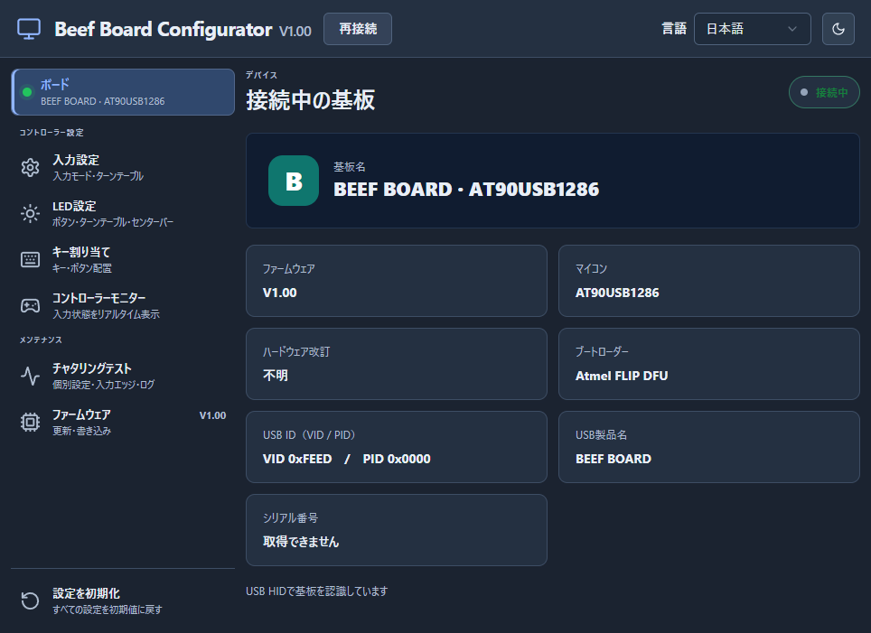
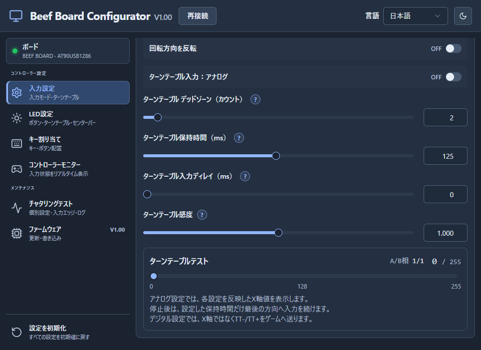
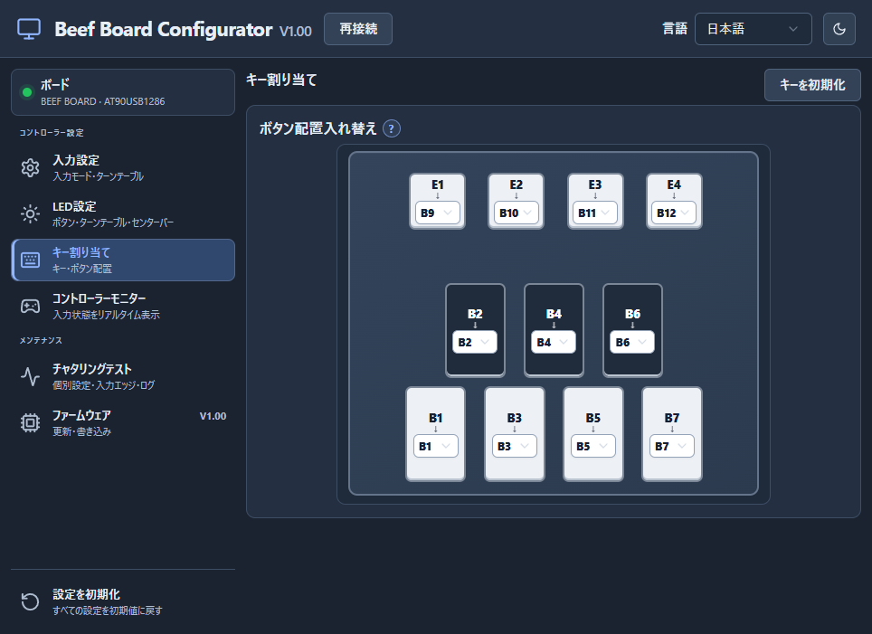
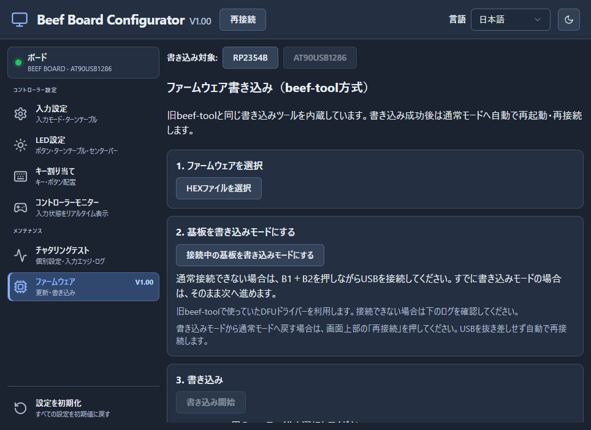

# Beef Board RP2354B

Beef Board RP2354B の基板設計、ファームウェア、Windows 用 Configurator をまとめたプロジェクトです。Configurator は、RP2354B と従来の AT90USB1286 の2種類のマイコンを搭載した基板に対応します。

## 開発とソースコードの由来

基板、ファームウェア、Configurator の設計・実装・デバッグ・文書作成に AI を活用しています。仕様と設計の採用判断はプロジェクト管理者が行います。実機での確認状況は各ファームウェアの README に記載しています。

Configurator は [HWXLR8/beef-board](https://github.com/HWXLR8/beef-board) を基にした Beef Board ソフトウェアのフォーク／派生コードを出発点として、RP2354B 対応を加えています。

## Configurator

Beef Board Configurator は、IIDX 系コントローラーの設定・調整・診断を行う Windows アプリです。基板を USB 接続し、入力方式やターンテーブル、LED、キー割り当てを設定できます。コントローラーモニターでボタンやターンテーブルの入力状態も確認できます。

### はじめに

1. [V1.00のリリースページ](https://github.com/okapi2dx/Beef-Board-RP2354B/releases/tag/V1.00)から Windows 用 Configurator をダウンロードして起動します。
2. 基板をUSB接続し、画面上部の **「接続」** を押します。接続できると、左側に基板名と緑の接続表示が出ます。
3. 左側のメニューから調整したい機能を選びます。設定の変更は基板へ自動で反映されます。項目横の **「?」** で設定の意味を確認できます。

以下の画像は、**AT90USB1286実機（ファームウェアV1.00）を接続した最新のWindowsアプリ**を、**日本語・ダークモード・通常のウィンドウサイズ**で撮影したものです（2026年10月6日）。疑似入力は使用していません。画像の数値は接続した基板の設定で、初期値とは限りません。表示される項目は基板・ファームウェア・入力モードによって異なります。

現在のリリースでは、デッドゾーンはエンコーダーカウント、感度は倍率で設定します。新しい仕様を使うには、アプリと使用する基板のファームウェアを両方更新してください。同じV1.00でも配布内容を更新しているため、リリースページから最新ファイルを取得してください。

### 1. ボード情報 — 接続先とバージョンを確認

左上の **「ボード」** を押すと、基板名、マイコン、ファームウェア、ブートローダー、USB IDなどを確認できます。接続先が正しいか、更新対象がAT90版かRP版かを確認するときに使います。基板が提供しない情報は「不明」「取得できません」と表示されます。

### 2. 入力設定 — ゲームに合わせてターンテーブルを調整

**Default / IIDX Entry / IIDX Premium** のコントローラーモードと、**Joystick / Keyboard** の入力方式を選べます。ターンテーブルの回転方向も反転できます。アナログターンテーブルを使う場合は、入力モードをJoystickにします。

| 設定 | 調整できること |
|---|---|
| アナログ / デジタル | アナログではX軸、デジタルではTT− / TT＋（JoystickではB13 / B14）として回転を送信 |
| デッドゾーン | 0～50エンコーダーカウント。設定数を超えるまで小さな回転を無視し、超えた後は回転に応じて入力。0で無効 |
| 保持時間 | 最後に採用した回転から、設定時間だけ入力を維持。ゆっくり回したときに入力が途切れる場合の調整に使用 |
| 入力ディレイ | 回転から入力が反映されるまでの遅延。0msで遅延なし |
| 感度 | 0.000～2.000を0.001刻みで調整。1.000が基準、0.500で半分、2.000で2倍、0.000でターンテーブル入力を無効化 |

デッドゾーンは、感度を掛ける前のエンコーダーのA/B相信号から数えた回転量で判定します。感度を変えてもデッドゾーンのカウント基準は変わりません。たとえば2カウントなら、同じ方向へ2カウントまでの動きを無視し、3カウント目から入力します。

**「設定を初期化」** では、ターンテーブル感度は1.000、保持時間は0msに戻ります。アナログとデジタルは設定を共用し、デジタルへ切り替えたときに別の初期値を適用しません。

画面下部の **「ターンテーブルテスト」** では、A/B相と設定反映後のX軸（0～255）を確認できます。実機を回しながら、設定によって入力がどう変わるかを確認できます。デジタル設定では、ゲームに送る入力はX軸ではなくTT− / TT＋になります。

### 3. LED設定 — ボタン・リング・センターバーの発光を調整

ボタンLEDは **明るさ・フェードアウト時間・点灯反転** を調整できます。フェードアウト時間を設定すると、ボタンを離した後に光が徐々に消えます。LED全体を無効にする設定もあります。

ターンテーブルのリングは、固定色、回転、シフト、レインボー、反応、呼吸、HID連動などの発光効果を選べます。色の選択から色相・彩度・明るさを調整できます。**「ターンテーブルとセンターバーの発光効果を連動」** をONにすると、センターバーにも同じ効果と色を反映し、OFFにすると個別に設定できます。

下部にはRGB LEDの更新頻度、レインボーの回転速度、ターンテーブルとセンターバーのLED数があります。現行ファームでは両基板とも各LED数を **0～255** で設定でき、0でその出力を無効にします。初期値はターンテーブル24個・センターバー16個です。接続したLED数に合わせて設定してください。

RP接続時は **「旧Phoenixwanを使用」** をONにすると、旧Phoenixwan用の7モードと色調整に切り替わります。色相・彩度・明るさを常に表示し、選択中のモードで調整できない項目はグレーアウトします。センターバーは固定表示で、色調整と消灯・中央2〜16灯を設定できます。旧Phoenixwan使用中はRGB LED更新頻度・回転速度・WS2812 LED数を非表示にし、発光効果の連動設定を無効にします。

### 4. キー割り当て — 配線を変えずにボタン配置を変更

Joystickモードでは、図の各物理ボタンからゲームへ送る論理ボタンを選べます。たとえばB1の割り当て先をB3にすると、物理B1を押したときにゲームにはB3として届きます。Keyboardモードでは、各ボタンやターンテーブルに送信するキーを割り当てられます。

B1〜B7とE1〜E4の物理配置を図で確認しながら変更できます。B1〜B7は実機に合わせた縦長の長方形で表示します。E1〜E4の標準の論理割り当てはB9〜B12です。

B8も割り当て先に選択できますが、**基板上にB8専用の物理ボタンやLEDはありません**。対応ファームウェアが必要です。

### 5. コントローラーモニター — 実機の入力と発光を確認

ボタンの押下、ターンテーブルのX軸、ゲームへ送るボタンの割り当て先をリアルタイムで確認できます。**1P / 2P** で表示する配置を切り替えられます。ターンテーブルをデジタルにすると、円盤を左右の **B13 / B14** に分け、採用された回転方向を点灯で表示します。保持時間や入力ディレイも反映されます。

リングとセンターバーにはLEDの発光状態を表示します。対応ファームウェアでは実機から届く発光情報を利用します。発光効果やファームウェアによってはアプリ側のプレビューを使うため、すべてのLED・効果の完全な再現を保証する表示ではありません。**「入力取得中」** は、基板からボタン・ターンテーブルなどの診断情報を受信している目印です。ボタンを押していないときでも、診断情報の受信中は表示されます。

撮影時はアナログ設定で、ボタンを押していない状態です。リングとセンターバーは、実機の診断情報と発光設定に基づく表示です。

### 6. チャタリングテスト — 二重入力の原因を調べて調整

実機のB1〜B7を操作すると、入力の変化を波形とログで確認できます。通常は7ボタンの **1秒間** の波形を表示します。ログは押下・解放で絞り込め、入力間隔やチャタリングの検知数・割合も確認できます。撮影画像は操作前の待機状態です。

波形右上の **「抑制前 / 抑制後」** で表示を切り替えます。抑制前は受信した生の入力履歴、抑制後はその履歴に現在の抑制設定を適用した波形です。0.0msで記録した履歴も、あとから設定した値で見直せます。過去ログの判定色も現在の設定に合わせて変わります。抑制後表示はアプリ内の再計算で、過去にゲームへ送った入力を書き換えるものではありません。

ログを選び、波形右上の **「詳細」** を押すと、そのボタンだけを **50ms幅** で大きく表示します。選択した入力が中央に来るため、細かな揺れを確認できます。**「戻る」** で選択したログの通常表示へ戻ります。波形のエッジをクリックしてフォーカスし、ドラッグで表示位置を移動できます。新しい入力を受信すると、ログと波形が最新の位置へ戻ります。

抑制時間は **押下時 / 解放時を別々に、ボタンごとに0.0～16.0ms（0.1ms単位）** で設定できます。一括設定にも対応します。0.0msでその操作側の抑制を無効にします。最初の押下・解放は即時に採用し、採用した操作から設定時間内の逆側への揺れを抑制します。逆側の入力が抑制期間の終わりまで続いた場合は、期間満了時に採用します。

**「自動設定」** をONにすると、検知した揺れに合わせて押下時・解放時の抑制時間を変更します。調整後は実際のゲームで入力の感触を確認してください。波形は基板から受信した履歴の範囲で表示し、通信で欠落した区間を実測波形として補いません。

### 7. ファームウェア — 基板に合ったファイルで更新

**アプリのEXEと基板のファームウェアは別のファイルです。** リリースページで、使っている基板に合ったファイルを選びます。

| 基板 | ファイル | 更新方法 |
|---|---|---|
| AT90USB1286 | HEX | アプリでファイルを選択 → 基板を書き込みモードへ切り替え → 書き込み開始 |
| RP2354B | UF2 | アプリの案内に従って取得 → BOOTSELモードで接続 → 表示されたUSBドライブへ手動コピー |

AT90版は旧beef-tool方式の書き込みツール（avrdude）をアプリに同梱しており、別途Pythonやbeef-toolを起動せずに更新できます。HEXファイルの確認、書き込み・照合のログ、結果を表示し、成功後は通常モードへ自動で再起動・再接続します。DFUドライバーは旧beef-toolで使用していたものを利用します。

画像は更新前の案内画面です。撮影のためのファームウェア書き込みは行っていません。詳しい手順は [ConfiguratorのREADME](configurator/README.md) と [ファームウェアのREADME](firmware/README.md) を参照してください。

### 表示とアプリ更新

画面右上で **日本語 / English** と **ライト / ダークテーマ** を切り替えられます。標準デザインはシンプルライトで、選んだテーマは保存されます。今回のスクリーンショットはすべて日本語・ダークテーマです。各設定の **「?」** には、ライト・ダークそれぞれで背景と区別しやすいツールチップを表示します。

アプリ更新の確認にも対応しています。同じV1.00の配布ファイルを差し替えた場合は、バージョン比較で通知されないことがあるため、リリースページから最新版を取得してください。

## 旧PHOENIXWAN UART

RP2354B基板のUART端子は、**旧PHOENIXWANのターンテーブルリングとセンターバーLEDを接続して制御する用途**です。ターンテーブルリングはJ42、センターバーはJ43に接続し、ConfiguratorのLED設定に合わせて制御します。このUART機能はAT90USB1286基板にはありません。

UARTプロトコルで設定できる色や発光パターンには制限があります。対応する制御内容と接続上の注意は [`firmware/README.md`](firmware/README.md) を参照してください。旧PHOENIXWAN実機での接続確認は未実施です。

## 電源選択（J2）

J2「POWER SELECT」のショート位置で、USBケーブル1本または2本の使い方を選べます。

| 使い方 | J2の設定 | 接続方法 |
|---|---|---|
| USBケーブル1本 | 1–2を短絡 | メインUSB端子に接続。基板本体とすべてのLEDに給電 |
| USBケーブル2本 | 2–3を短絡 | メインUSB端子で基板本体とボタンLEDに給電し、もう一方のUSB端子でターンテーブルとセンターバーのLEDに給電 |

J2には2.54 mmピッチの3ピンヘッダとショートピンを取り付けます。基板の印字「1・2・3」を確認し、ショートピンは1–2または2–3のどちらか一方だけに取り付けてください。
