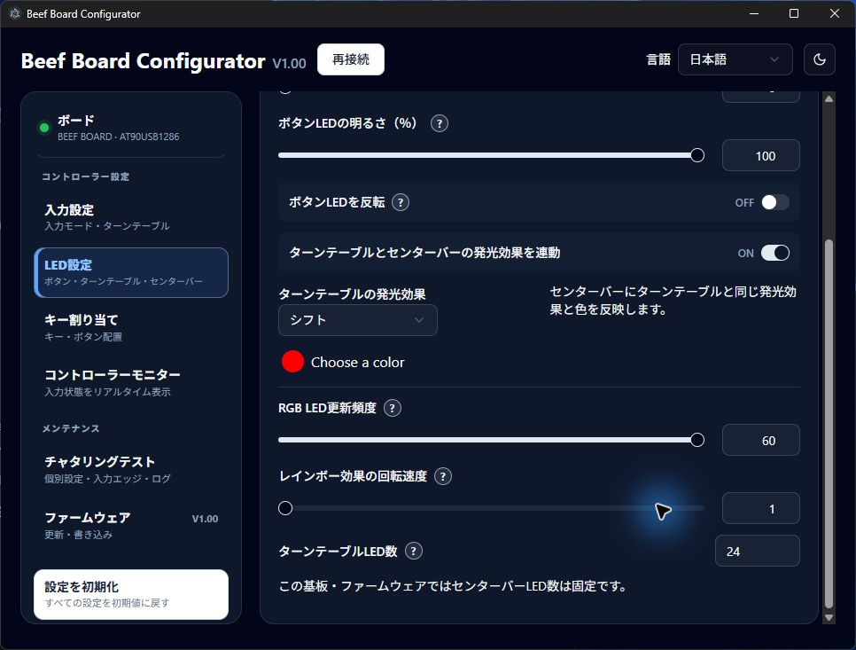
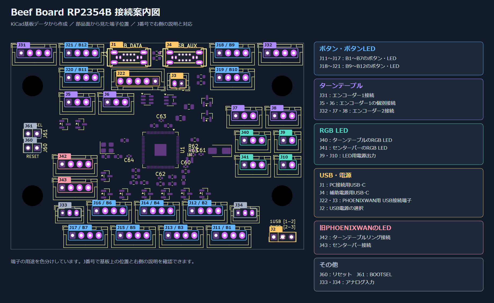

# Beef Board RP2354B

Beef Board RP2354B の基板設計、ファームウェア、Windows 用 Configurator をまとめたプロジェクトです。Configurator は、RP2354B と従来の AT90USB1286 の2種類のマイコンを搭載した基板に対応します。

## 開発とソースコードの由来

基板、ファームウェア、Configurator の設計・実装・デバッグ・文書作成に AI を活用しています。仕様と設計の採用判断はプロジェクト管理者が行います。実機での確認状況は各ファームウェアの README に記載しています。

Configurator は [HWXLR8/beef-board](https://github.com/HWXLR8/beef-board) を基にした Beef Board ソフトウェアのフォーク／派生コードを出発点として、RP2354B 対応を加えています。

## Configurator

RP2354B・AT90USB1286に対応するWindowsアプリです。入力、LED、キー割り当てを設定し、モニターと波形で動作を確認できます。

[V1.00リリース](https://github.com/okapi2dx/Beef-Board-RP2354B/releases/tag/V1.00)から最新のアプリと基板用ファームを取得し、USB接続後に **「接続」** を押してください。設定は基板へ自動反映され、各項目の **「?」** で説明を確認できます。

以下は現在のアプリを日本語・ダークモードで表示した例です。画像内の入力・数値は説明用のサンプルです。

### 入力設定

入力モードを **ジョイスティック / キーボード** から選び、ターンテーブルの回転方向やアナログ / デジタル入力を設定します。下部の **X軸** で回転による入力を確認できます。

- **デッドゾーン：0～50カウント。** 小さな回転を無視する範囲です。0で無効になります。
- **感度：0.000～2.000。** 1.000が基準、0.500で半分、2.000で2倍の距離を進みます。0で入力無効、初期値は1.000です。
- **保持時間：** デジタル入力が途切れる場合に調整します。アナログ入力にはジョイスティックモードを使用してください。

### LED・RGB設定

**「ボタンLED設定」** では、ボタンの明るさ・フェードアウト時間・点灯反転を調整します。**「RGB LED設定」** では、ターンテーブルとセンターバーの色・発光効果を設定します。

- **連動：** ターンテーブルとセンターバーを同じ色・発光効果にできます。
- **変化速度：** 回転・シフト・動くレインボー・呼吸の速度を1～5で調整します。自動で色が変わる効果では、色選択がグレーアウトします。
- **LED数：** 接続したLED数に合わせて各0～255で設定します。初期値はターンテーブル24個、センターバー16個。0でそのLED出力を無効にします。
- **旧PHOENIXWAN：** RP2354BではUART接続によるLED制御に対応します。

| ボタンLED設定 | RGB LED設定 |
|---|---|
|  |  |

### コントローラーモニター

ボタンの入力、X軸、割り当て先とLEDの光り方を確認できます。**1P / 2P** で配置を切り替え、デジタル入力では回転方向を **B13 / B14** の点灯で表示します。

### チャタリングテスト

**B1～B7の波形と入力ログ** を見ながら、押下時・解放時の抑制を各 **0.0～16.0ms** で調整できます。一括設定と自動設定にも対応します。

**「抑制前 / 抑制後」** で、元の入力と現在の設定を適用した波形を比較します。ログを選んで **「詳細」** を押すと、そのボタンの50ms区間を拡大します。2つのエッジを選ぶと、間の押下・解放時間を測定できます。

### キー割り当て・ファームウェア更新

**「キー割り当て」** で、ボタンの割り当て先やキーボード入力のキーを変更できます。**「ファームウェア」** から更新方法を確認してください。AT90USB1286はHEXをアプリから書き込み、RP2354BはUF2をBOOTSELのUSBドライブへコピーします。

ライト / ダークと日本語 / Englishを切り替えられます。詳しい手順は [ConfiguratorのREADME](configurator/README.md)、[ファームウェアのREADME](firmware/README.md) を参照してください。

## 旧PHOENIXWAN UART

RP2354B基板のUART端子は、**旧PHOENIXWANのターンテーブルリングとセンターバーLEDを接続して制御する用途**です。ターンテーブルリングはJ42、センターバーはJ43に接続し、ConfiguratorのLED設定に合わせて制御します。このUART機能はAT90USB1286基板にはありません。

UARTプロトコルで設定できる色や発光パターンには制限があります。対応する制御内容と接続上の注意は [`firmware/README.md`](firmware/README.md) を参照してください。旧PHOENIXWAN実機での接続確認は未実施です。

## 電源選択（J2）

J2「POWER SELECT」のショート位置で、USBケーブル1本または2本の使い方を選べます。

| 使い方 | J2の設定 | 接続方法 |
|---|---|---|
| USBケーブル1本 | 1–2を短絡 | メインUSB端子に接続。基板本体とすべてのLEDに給電 |
| USBケーブル2本 | 2–3を短絡 | メインUSB端子で基板本体とボタンLEDに給電し、もう一方のUSB端子でターンテーブルとセンターバーのLEDに給電 |

J2には2.54 mmピッチの3ピンヘッダとショートピンを取り付けます。基板の印字「1・2・3」を確認し、ショートピンは1–2または2–3のどちらか一方だけに取り付けてください。

## 基板の接続案内

端子の位置と用途をまとめた接続案内図です。J番号で接続先を確認できます。

[接続案内図を拡大する](docs/wiring/connection-guide.png) · [SVG版](docs/wiring/connection-guide.svg)

J18～J21の標準入力は **B9～B12** です。キー割り当てを変更した場合は、設定した出力になります。
