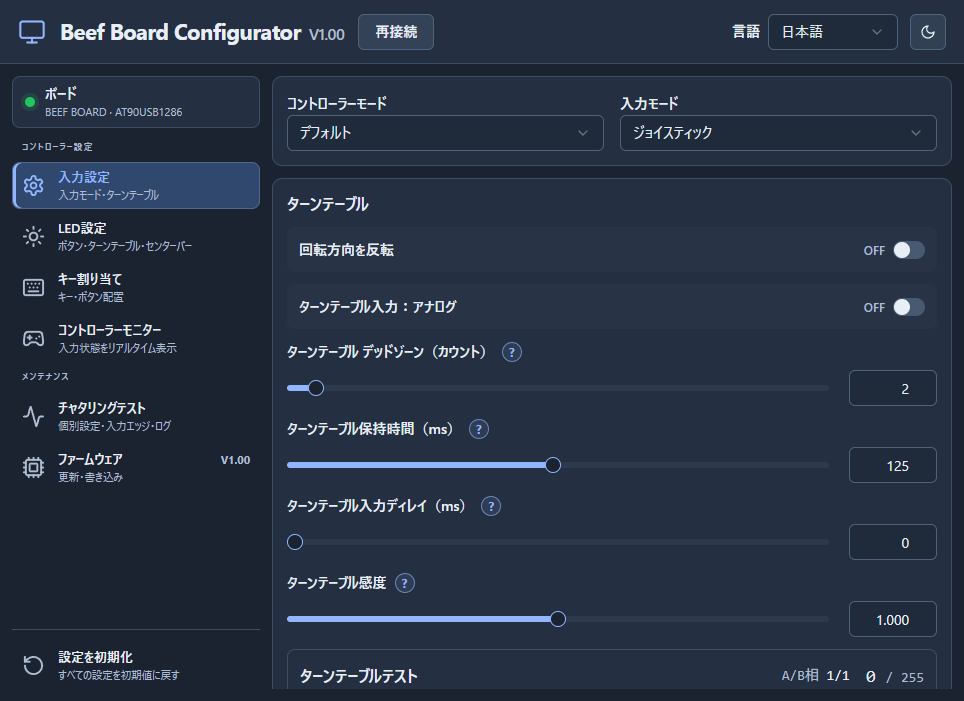
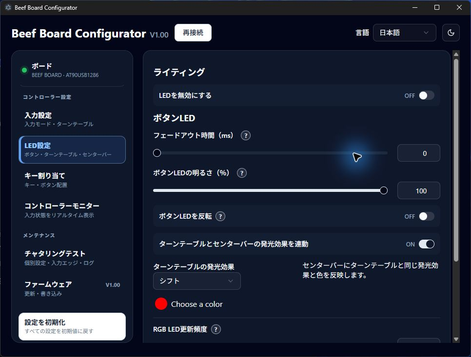
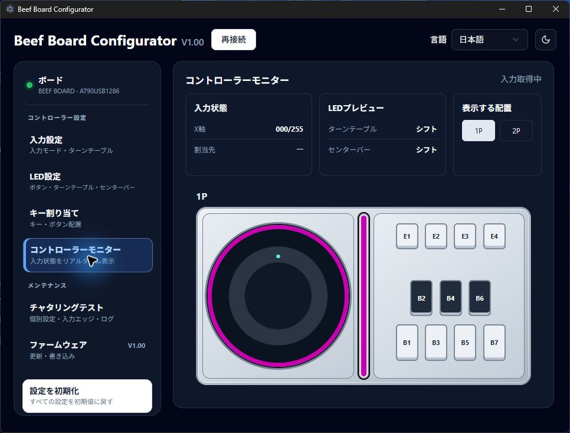
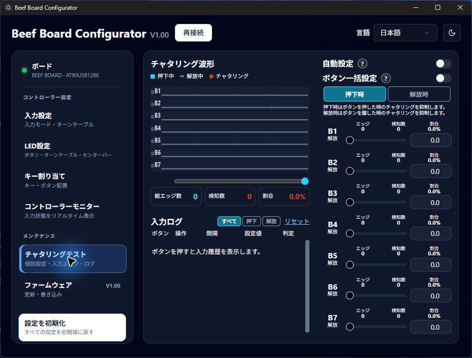

# Beef Board RP2354B

Beef Board RP2354B の基板設計、ファームウェア、Windows 用 Configurator をまとめたプロジェクトです。Configurator は、RP2354B と従来の AT90USB1286 の2種類のマイコンを搭載した基板に対応します。

## 開発とソースコードの由来

基板、ファームウェア、Configurator の設計・実装・デバッグ・文書作成に AI を活用しています。仕様と設計の採用判断はプロジェクト管理者が行います。実機での確認状況は各ファームウェアの README に記載しています。

Configurator は [HWXLR8/beef-board](https://github.com/HWXLR8/beef-board) を基にした Beef Board ソフトウェアのフォーク／派生コードを出発点として、RP2354B 対応を加えています。

## Configurator

RP2354B・AT90USB1286に対応するWindowsアプリです。入力、LED、キー割り当てを設定し、モニターと波形で動作を確認できます。

[V1.00リリース](https://github.com/okapi2dx/Beef-Board-RP2354B/releases/tag/V1.00)から最新のアプリと基板用ファームを取得し、USB接続後に **「接続」** を押してください。設定は基板へ自動反映され、各項目の **「?」** で説明を確認できます。

画像は2026年10月6日にAT90USB1286実機を接続し、日本語・ダークモードで撮影したものです。表示中の数値は保存済みの設定で、初期値とは限りません。

### 入力設定

コントローラーモードとJoystick / Keyboardを選び、ターンテーブルの回転方向、アナログ / デジタル、保持時間、入力ディレイを調整できます。

- **デッドゾーン：0～50カウント。** 設定数を超えるまで小さな回転を無視します。0で無効です。
- **感度：0.000～2.000。** 1.000が基準、0.500で半分、2.000で2倍、0で入力無効です。初期化で1.000に戻ります。

### LED設定

ボタンの明るさ・フェードアウト・点灯反転と、リング・センターバーの色や発光効果を設定できます。両基板ともLED数は各0～255で、0で出力を無効にします。初期値はリング24個・センターバー16個です。RPでは旧PHOENIXWANのUART制御にも対応します。

### コントローラーモニター

ボタン、X軸、割り当て先とLEDプレビューを確認できます。1P / 2Pで配置を切り替え、デジタル設定では回転方向を **B13 / B14** の点灯で表示します。「入力取得中」は基板の診断情報を受信している目印です。LED表示は発光情報と設定に基づくプレビューです。

### チャタリングテスト

B1〜B7の波形と入力ログを確認し、押下時・解放時の抑制を各 **0.0～16.0ms** で設定できます。最初の操作は即時に採用し、設定期間内の逆側への揺れを抑制します。一括設定と自動設定にも対応します。

**「抑制前 / 抑制後」** で生入力と現在の設定による再計算を比較できます。通常は7ボタン・1秒、ログを選んで **「詳細」** を押すと1ボタン・50msを表示します。エッジのクリックやドラッグで確認位置を移動でき、新しい入力で最新表示へ戻ります。

### キー割り当て・ファーム更新

Joystickでは物理ボタンの論理割り当て、Keyboardでは送信するキーを変更できます。B8は論理割り当て先で、専用の物理ボタンはありません。左上の **「ボード」** で接続先を確認できます。

**AT90はHEXをアプリから書き込み、RPはUF2をBOOTSELのUSBドライブへコピー**して更新します。アプリとファームは別ファイルです。同じV1.00の差し替えは更新通知が出ない場合があるため、リリースページから最新版を取得してください。

ライト / ダークと日本語 / Englishを切り替えられます。詳しい仕様・手順は [ConfiguratorのREADME](configurator/README.md)、[ファームウェアのREADME](firmware/README.md) を参照してください。

## 旧PHOENIXWAN UART

RP2354B基板のUART端子は、**旧PHOENIXWANのターンテーブルリングとセンターバーLEDを接続して制御する用途**です。ターンテーブルリングはJ42、センターバーはJ43に接続し、ConfiguratorのLED設定に合わせて制御します。このUART機能はAT90USB1286基板にはありません。

UARTプロトコルで設定できる色や発光パターンには制限があります。対応する制御内容と接続上の注意は [`firmware/README.md`](firmware/README.md) を参照してください。旧PHOENIXWAN実機での接続確認は未実施です。

## 電源選択（J2）

J2「POWER SELECT」のショート位置で、USBケーブル1本または2本の使い方を選べます。

| 使い方 | J2の設定 | 接続方法 |
|---|---|---|
| USBケーブル1本 | 1–2を短絡 | メインUSB端子に接続。基板本体とすべてのLEDに給電 |
| USBケーブル2本 | 2–3を短絡 | メインUSB端子で基板本体とボタンLEDに給電し、もう一方のUSB端子でターンテーブルとセンターバーのLEDに給電 |

J2には2.54 mmピッチの3ピンヘッダとショートピンを取り付けます。基板の印字「1・2・3」を確認し、ショートピンは1–2または2–3のどちらか一方だけに取り付けてください。
